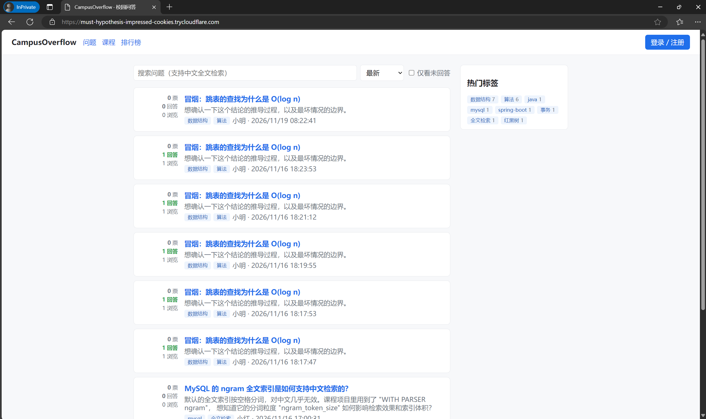
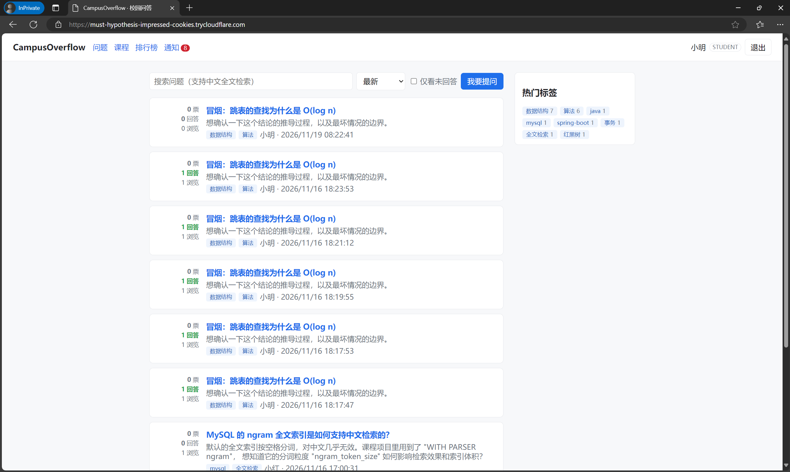
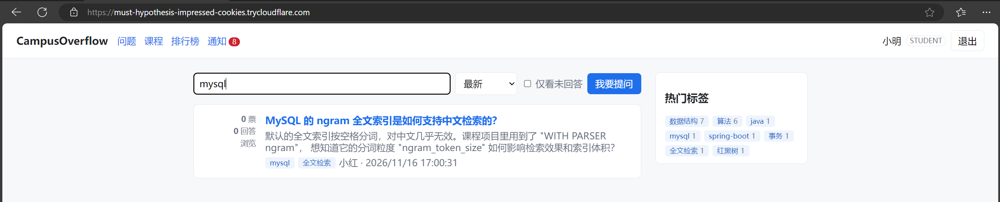
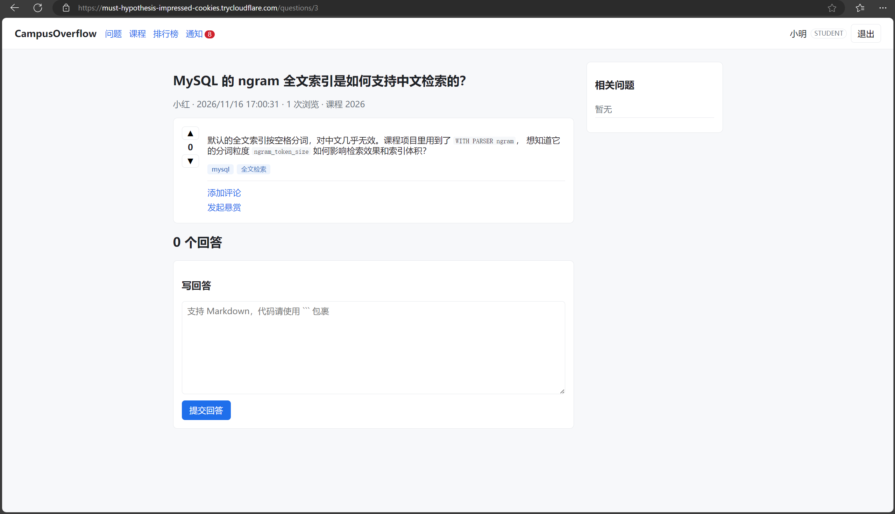

# Lab8 临时公网验证记录

- **验证时间**：2026-11-19 09:05
- **操作人**：易子恒 (moOvO760)
- **临时 URL**：`https://must-hypothesis-impressed-cookies.trycloudflare.com` (已关闭)
- **使用工具**：Docker + Cloudflare Tunnel (cloudflare/cloudflared)
- **环境说明**：本地 Docker Compose 全栈环境（dev,demo），仅暴露前端 80 端口，无真实 Secret 暴露。

## 验证步骤与截图

1. **首页访问正常**：
   

2. **登录成功**：
   

3. **搜索列表正常**：
   

4. **详情页正常**：
   

## 结论
临时公网隧道验证通过。验证完毕后已立即关闭隧道，非常驻上线。
