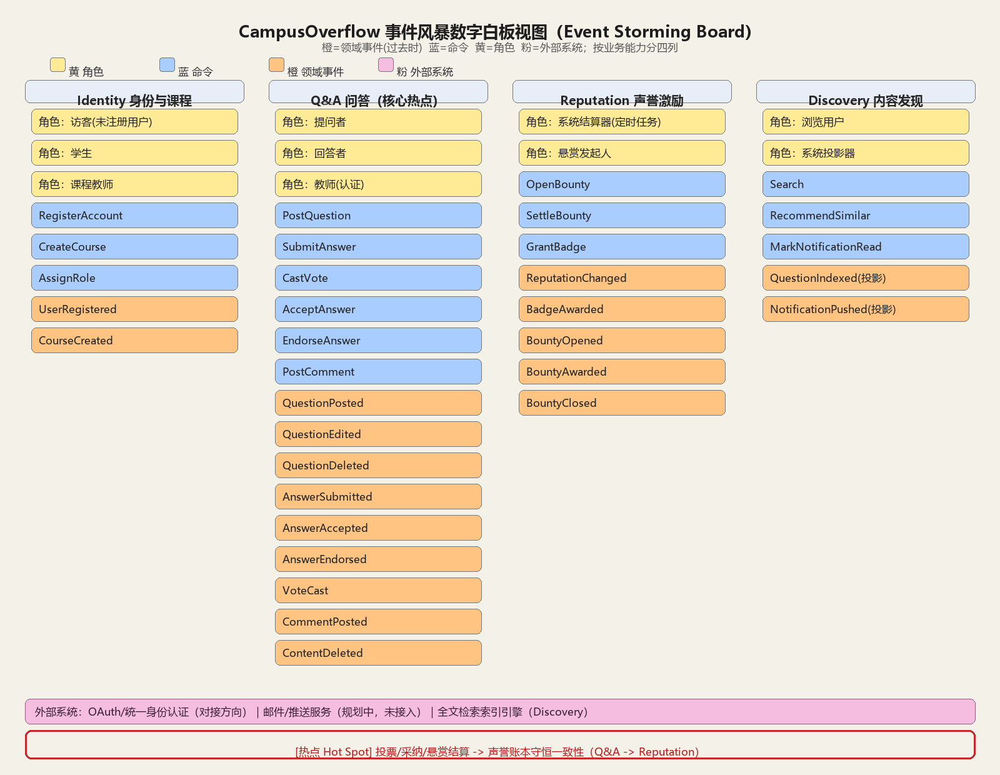

# 事件风暴记录（Event Storming）

> Lab3 事件风暴工作坊整理：黄色=角色，蓝色=命令，橙色=领域事件（过去时、业务术语），粉色=外部系统；按业务能力划分限界上下文，不按技术分层。事件清单与 `events-catalog.md`、关系与 `context-map.md` 一致。

## 一、白板全景（数字白板视图）

## 二、角色（黄色）

| 角色 | 所属上下文 | 主要诉求 |
| --- | --- | --- |
| 访客（未注册用户） | Identity | 浏览、注册登录 |
| 学生 | Q&A / Discovery | 提问、回答、投票、搜索、看通知 |
| 课程教师 | Q&A / Identity | 背书回答、管理课程成员 |
| 系统结算器（定时任务） | Reputation | 悬赏结算、每日上限复核、对账 |
| 悬赏发起人 | Reputation | 用声誉发起/关闭悬赏 |
| 浏览用户 | Discovery | 检索、看相关推荐与通知 |
| 系统投影器 | Discovery | 把领域事件转成搜索/通知读模型 |

## 三、命令（蓝色，谁触发什么动作）

| 命令 | 触发角色 | 所属上下文 |
| --- | --- | --- |
| RegisterAccount | 访客 | Identity |
| CreateCourse / AssignRole | 课程教师 | Identity |
| PostQuestion | 学生 | Q&A |
| SubmitAnswer | 学生 | Q&A |
| CastVote（含改票/撤销） | 学生 | Q&A |
| AcceptAnswer | 提问者 | Q&A |
| EndorseAnswer | 课程教师 | Q&A |
| PostComment | 学生 | Q&A |
| OpenBounty / SettleBounty | 发起人 / 结算器 | Reputation |
| GrantBadge | 结算器 | Reputation |
| Search / RecommendSimilar / MarkNotificationRead | 浏览用户 | Discovery |

## 四、领域事件（橙色，过去时业务术语，共 18 个，满足 ≥10）

| # | 领域事件 | 发布时机 | 主要消费者 | 上下文 |
| --- | --- | --- | --- | --- |
| 1 | UserRegistered | 用户注册成功 | Reputation（开户）、Discovery | Identity |
| 2 | CourseCreated | 课程创建 | Q&A | Identity |
| 3 | QuestionPosted | 问题发布 | Discovery（搜索投影） | Q&A |
| 4 | QuestionEdited | 问题编辑 | Discovery | Q&A |
| 5 | QuestionDeleted | 问题软删除 | Discovery（标记删除） | Q&A |
| 6 | AnswerSubmitted | 回答提交 | Discovery、Reputation | Q&A |
| 7 | AnswerAccepted | 采纳最佳回答 | Reputation（+声誉/徽章）、Discovery | Q&A |
| 8 | AnswerEndorsed | 教师背书回答 | Reputation（徽章）、Discovery | Q&A |
| 9 | VoteCast | 投票/改投/撤销 | Reputation（计分）、Discovery | Q&A |
| 10 | CommentPosted | 评论发布 | Discovery（@提及） | Q&A |
| 11 | ContentDeleted | 内容软删除 | Discovery（标记删除） | Q&A |
| 12 | ReputationChanged | 声誉分值变动 | Discovery（排行榜） | Reputation |
| 13 | BadgeAwarded | 授予徽章 | Discovery（通知） | Reputation |
| 14 | BountyOpened | 悬赏发起 | Discovery | Reputation |
| 15 | BountyAwarded | 悬赏结算给回答者 | Discovery | Reputation |
| 16 | BountyClosed | 悬赏关闭/退款 | Discovery | Reputation |
| 17 | QuestionIndexed | 问题进入检索索引（投影） | Discovery 内部 | Discovery |
| 18 | NotificationPushed | 事件生成通知（投影） | Discovery 内部 | Discovery |

命名约束：一律使用业务动词过去式（Posted / Accepted / Cast / Awarded），不使用"用户操作完成""数据处理成功"这类抽象事件。

## 五、外部系统（粉色）

| 外部系统 | 状态 | 对接方式 |
| --- | --- | --- |
| OAuth / 统一身份认证 | 对接方向已明确 | Identity 上游认证 |
| 邮件 / 推送服务 | 规划中，当前未接入 | 后续由 Notification 上下文异步投递 |
| 全文检索索引引擎 | Discovery 内部能力 | 基于分词索引做中文检索 |

## 六、主链路时间线

注册登录（UserRegistered）→ 发帖（QuestionPosted）→ 提交回答（AnswerSubmitted）→ 投票/采纳/背书（VoteCast、AnswerAccepted、AnswerEndorsed）→ 声誉与徽章变动（ReputationChanged、BadgeAwarded、BountyAwarded）→ 搜索投影与通知（QuestionIndexed、NotificationPushed）。

## 七、热点（Hot Spot）

**Q&A 与 Reputation 之间的计分/结算一致性**：投票改票按新旧效果差结算、悬赏只能结算一次、冻结-扣减-退还必须守恒，是全系统一致性最复杂处；据此把 `Vote`、`ReputationAccount`、`Bounty` 切成独立聚合，跨聚合只走领域事件。

## 八、上下文划分（按业务能力，非技术分层）

| 上下文 | 业务能力 | 子域类型 |
| --- | --- | --- |
| Identity | 注册、认证、角色、课程成员 | 支撑子域 / 上游 OHS+PL |
| Q&A | 问题、回答、投票、评论、采纳、教师背书 | 核心域 |
| Reputation | 声誉账本、每日上限、徽章、悬赏、排行榜、对账 | 核心域 |
| Discovery | 搜索、全文检索、相关推荐、通知、@提及 | 支撑/通用子域 |

> 说明：本页白板为数字白板视图，由事件风暴分析整理导出；若后续补拍实体墙面工作坊照片，可追加在本节下方。
